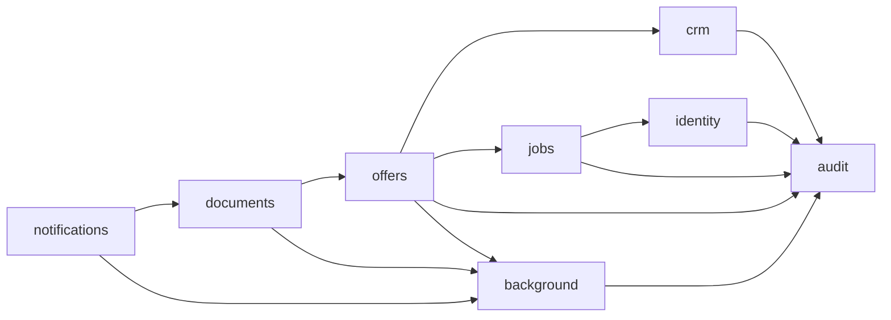

# Architektura modułowego monolitu

Stan: F02. Kod działa w jednej aplikacji Spring Boot i jednej bazie PostgreSQL. Granice logiczne egzekwuje Spring Modulith 2.1.1. Istotne uzasadnienia zapisuje [ADR-001](adr/ADR-001-module-boundaries-and-jobs-contract.md).

## Własność i stan modułów

| Moduł | Odpowiedzialność | Stan implementacji |
|---|---|---|
| `identity` | Konta, role, logowanie i sesje | Działająca implementacja |
| `crm` | Klienci i adresy | Zarezerwowana granica; implementacja od C01 |
| `offers` | Oferty, pozycje i akceptacja | Zarezerwowana granica; implementacja od O01 |
| `jobs` | Zlecenia i wykonanie prac | Publiczny kontrakt przyjęcia oferty; implementacja od J01 |
| `audit` | Trwały dziennik istotnych operacji | Zarezerwowana granica; implementacja od F08 |
| `background` | Trwała kolejka, retry i wykonanie zadań | Zarezerwowana granica; implementacja od F09 |
| `documents` | Dokumenty i PDF | Zarezerwowana granica |
| `notifications` | Powiadomienia | Zarezerwowana granica |
| `shared` | Techniczne ustawienia czasu i serializacji | Konfiguracja techniczna; bez encji biznesowych |

Każdy moduł jest `CLOSED`. Jego podpakiety, w tym `domain`, `persistence`, `application`, `security` i `web`, są wewnętrzne, dopóki konkretny pakiet nie otrzyma `@NamedInterface`. Publiczność klasy Java umożliwia współpracę wewnątrz modułu; nie stanowi zgody na import z innego modułu. Kontroler HTTP również nie jest API Java dla innych modułów.

## Obowiązujące zależności

Aktualna dozwolona zależność pomiędzy modułami biznesowymi to `offers -> jobs :: api`. Jest zadeklarowana przed implementacją akceptacji oferty. Pozostałe moduły mają `allowedDependencies = {}`. Zależności do bibliotek JDK i Spring nie są zależnościami pomiędzy modułami aplikacji. Moduły korzystające z zegara wstrzykują `java.time.Clock`, a nie klasę konfiguracyjną `shared`.

Obecnie jedynym nazwanym kontraktem jest `pl.instalflow.jobs.api`, wystawiony jako `jobs :: api`. Encje JPA i repozytoria pozostają wewnętrzne. Relację do obiektu innego modułu przechowujemy jako UUID; odczyt wartości odbywa się przez uzgodnione API, a nie przez obce repozytorium ani między-modułowe `@ManyToOne`.

## Plan zależności przy kolejnych funkcjach

Poniższy graf ustala kierunek rozbudowy. Nie otwiera tych importów teraz: każda nowa zależność wymaga konkretnego kontraktu, aktualizacji `package-info.java` oraz testów.



`shared` nie zależy od modułów biznesowych. Zlecenie PDF przechodzi przez `background`; `documents` pobiera dane oferty przez przyszłe API `offers`. Dzięki temu nie powstaje cykl `offers <-> documents`. To kierunki zależności kodu, a nie pełny diagram przepływu zdarzeń czy ruchu HTTP.

## Kontrakt utworzenia zlecenia

`Jobs.createFromAcceptedOffer(CreateFromAcceptedOffer)` przyjmuje niezmienną migawkę chwili akceptacji i zwraca `CreatedWorkOrder(id, reference)`.

Komenda zawiera identyfikator oferty, klienta, adresu i akceptującego użytkownika; nazwę i kontakt klienta; ulicę, kod pocztowy i miejscowość; uzgodnione pozycje materiałów/robocizny; sumę netto w PLN; czas akceptacji i opcjonalny planowany początek. Pozycja ma typ `MATERIAL` albo `LABOR`, opis, dodatnią ilość (maksymalnie 3 miejsca po przecinku), jednostkę i nieujemną cenę jednostkową netto (maksymalnie 2 miejsca). Suma netto ma maksymalnie 2 miejsca po przecinku.

Konstruktor kopiuje listę pozycji przez `List.copyOf`. Rekordy nie zawierają mutowalnych kolekcji ani encji. Kopia danych zapewnia, że późniejsza edycja klienta, adresu czy oferty nie zmienia uzgodnionej treści zlecenia. Kontrakt nie przelicza cen i sum: reguły rabatów, podatku i zaokrągleń należą do implementacji oferty. Implementacja J01 ma zapewnić idempotencję po `sourceOfferId`, aby ponowienie akceptacji nie utworzyło drugiego zlecenia.

W F02 nie rejestrujemy implementacji `Jobs`, tabel zleceń ani endpointów zleceń. Klasy kontraktu definiują granicę, którą wykorzystają O01/J01.

## Weryfikacja

`ModularityTests` uruchamia `ApplicationModules.verify()` na rzeczywistym kodzie, sprawdza kompletną listę zamkniętych modułów i zakazuje wystawiania encji JPA/repozytoriów. Dwa negatywne przykłady znajdują się pod `src/test/java/architecturefixtures`, poza skanowaniem aplikacji: niedozwolony import wewnętrznej klasy oraz cykl pomiędzy publicznymi API. Testy wymagają, aby ten sam weryfikator odrzucił oba przykłady. Test kontraktu sprawdza niezmienność migawki oraz odrzucenie liczb o nieuzgodnionej precyzji.

```bash
./mvnw test -Dtest=ModularityTests,AcceptedOfferContractTests
```

Podstawa techniczna: [Spring Modulith — Fundamentals](https://docs.spring.io/spring-modulith/reference/fundamentals.html), [weryfikacja struktury](https://docs.spring.io/spring-modulith/reference/verification.html).
